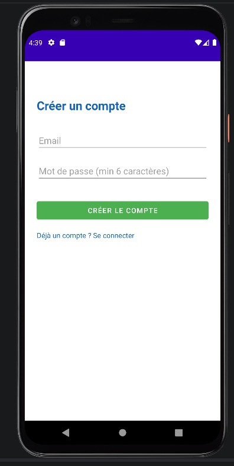
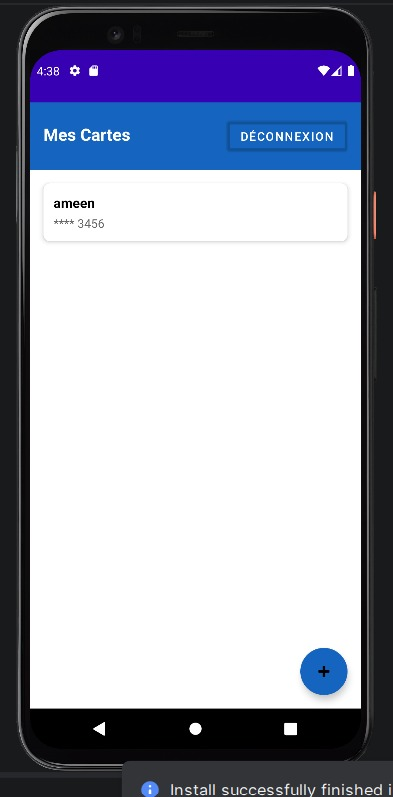
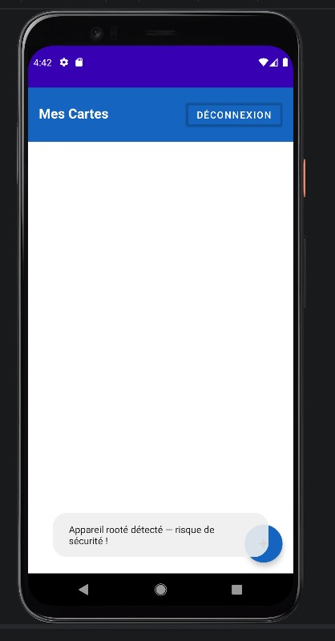

# 💳 SecureWallet

**Application Android de gestion sécurisée de cartes bancaires, construite selon une approche de défense en profondeur.**

Projet académique — ENSIAS, filière Cybersecurity, Cloud & Mobile Computing — 2025/2026

[**📄 Lire le rapport (PDF)**](docs/Rapport_SecureWallet.pdf)

> **Avant de cloner.** Le fichier `app/google-services.json` n'est **pas** inclus (il est propre
> à chaque projet Firebase). Copiez `app/google-services.json.example` en
> `app/google-services.json` et remplacez les valeurs par celles de votre propre projet Firebase.

---

## Ce que fait l'application

SecureWallet permet à un utilisateur de s'authentifier, puis d'enregistrer et de consulter
ses cartes bancaires. L'accent n'est pas mis sur les fonctionnalités mais sur la **sécurité** :
chaque brique applique une protection complémentaire, de l'authentification jusqu'au stockage
local sur l'appareil.

  
  &nbsp;&nbsp;
  
  &nbsp;&nbsp;
  

## Architecture de sécurité (défense en profondeur)

| Pilier | Mise en œuvre | Fichier |
|--------|---------------|---------|
| **Authentification** | Firebase Authentication (email / mot de passe), session gérée côté cloud | `LoginActivity`, `RegisterActivity` |
| **Chiffrement des données** | AES-GCM 128 bits, IV aléatoire par chiffrement, clé générée et **isolée dans l'AndroidKeyStore** (jamais exposée à l'application) | `CryptoManager` |
| **Stockage local** | Base SQLCipher, cloisonnée par `user_id` (UID Firebase) : un utilisateur ne voit que ses propres cartes | `DatabaseHelper` |
| **Intégrité du dispositif** | Détection de root, d'émulateur et de débogage actif ; alerte l'utilisateur sur un environnement compromis | `SecurityChecker` |

Point de conception notable : l'application ne stocke **pas** le numéro de carte complet,
seulement le nom du titulaire et les **4 derniers chiffres** — et ces deux champs sont
eux-mêmes chiffrés avant insertion en base.

## Pile technique

`Android (Java)` · `Firebase Authentication` · `AndroidKeyStore` · `AES-GCM` · `SQLCipher` · `Gradle`

## Compilation

1. Cloner le dépôt et l'ouvrir dans Android Studio.
2. Créer un projet sur la [console Firebase](https://console.firebase.google.com/), y activer
   l'authentification e-mail / mot de passe, et télécharger votre `google-services.json`.
3. Placer ce fichier dans `app/` (voir `app/google-services.json.example`).
4. Lancer la compilation et le déploiement sur un appareil ou un émulateur.

## Analyse de sécurité

### Points forts
- Clé de chiffrement **matériellement isolée** dans l'AndroidKeyStore : elle ne peut pas être
  extraite de l'application, même sur un appareil compromis.
- AES-GCM fournit confidentialité **et** authenticité (détection d'altération).
- Cloisonnement strict des données par UID Firebase.
- Minimisation des données : pas de numéro de carte complet stocké.
- Détection active des environnements à risque (root, émulateur, débogage).

### Limites connues et pistes
- **Mot de passe SQLCipher en dur dans le code** (`DatabaseHelper`). Comme il est inclus dans
  l'APK, il peut être extrait par décompilation. La donnée reste protégée par le chiffrement
  AES-GCM applicatif (clé dans l'AndroidKeyStore), mais la passphrase de la base devrait être
  dérivée de l'AndroidKeyStore plutôt que codée en dur.
- La détection de root/émulateur **avertit** sans bloquer l'accès ; une politique plus stricte
  pourrait refuser le lancement sur appareil compromis.
- Pas de verrouillage biométrique ni de délai d'expiration de session local.

Détails complets dans le [rapport](docs/Rapport_SecureWallet.pdf).

## Licence

Distribué sous licence [MIT](LICENSE).
